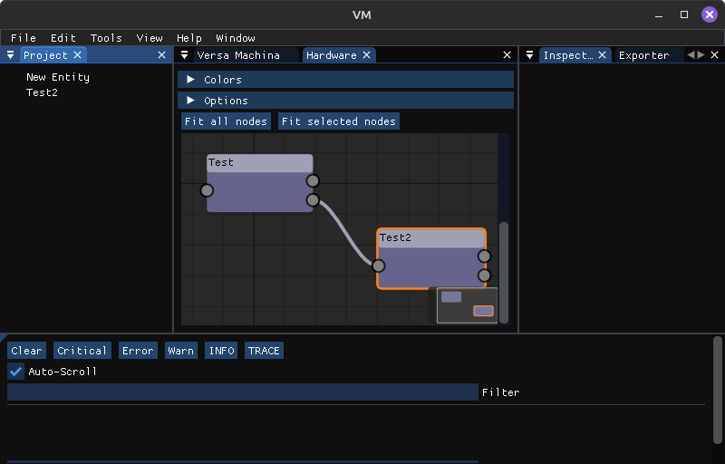

# VersaMachina
**An open, cross-platform electrical design and documentation tool for automotive projects.**

VersaMachina (VM) provides a modern workflow for creating, validating, and documenting complete vehicle electrical systems. It uses block-based module definitions, a visual node graph editor, and a modular pack system to make wiring design intuitive, scalable, and machine-readable.

VM is built to support:
- automotive startups  
- kit car and EV-conversion builders  
- modders and hobbyists  
- research teams and FSAE  
- small OEMs  
- open hardware developers  

> **Status:** Active development. MVP focuses on BlockSpec, Packs, Node Editor, and basic export functionality.

---

## Features (Current + Planned)

### BlockSpec
A simple, YAML-based schema defining:
- ports  
- signals  
- power + ground  
- CAN/LIN/I2C/SPI interfaces  
- optional troubleshooting metadata  

### Packs
Installable collections of modules in `.vm-pack.zip` or folder format.

### Visual Wiring Editor

A drag-and-drop node editor to define complete vehicle electrical graphs.

### Inspector + Hierarchy
Manage modules, ports, connections, and metadata.

### Export Engine
Outputs:
- netlists  
- wiring diagrams  
- module integration docs  
- vehicle profiles  

### Future Extensions
- automated troubleshooting flow generation  
- reference hardware (open designs)  
- CAN/LIN/UDS diagnostics  
- programmable modules  
- EV modeling  
- cloud pack registry  

---

## Goals
- Define an open, modern electrical standard for modular vehicle design.  
- Simplify wiring development for real automotive builds.  
- Enable vendors and creators to publish component libraries.  
- Make automotive electrical documentation reproducible and machine-generated.  
- Provide a foundation for future diagnostics and programming.

---

## Contributing
Contributions of all kinds are welcome:
- new BlockSpecs  
- Packs for community or vendor modules  
- UI improvements  
- exporters  
- documentation  
- bug fixes  
- reference hardware designs  

See **CONTRIBUTING.md** for full details.

---

## License
TBD (MIT, Apache 2.0, or similar recommended).  
Open hardware examples will follow a compatible open hardware license.

---

## Roadmap
See **ROADMAP.md** for detailed milestones and phase plan.

---

## Contact
Issues & PRs welcome through GitHub. Discussion channels to come.
